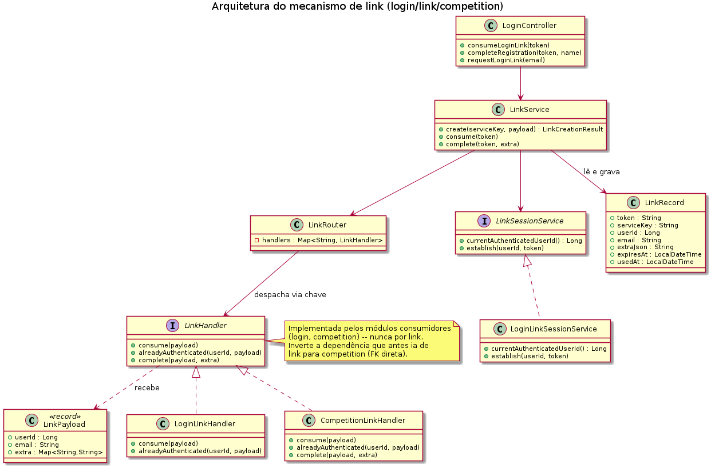
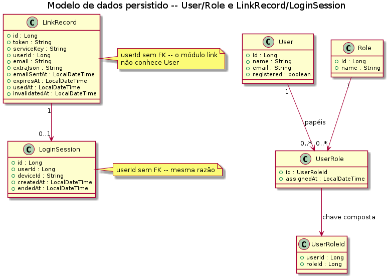
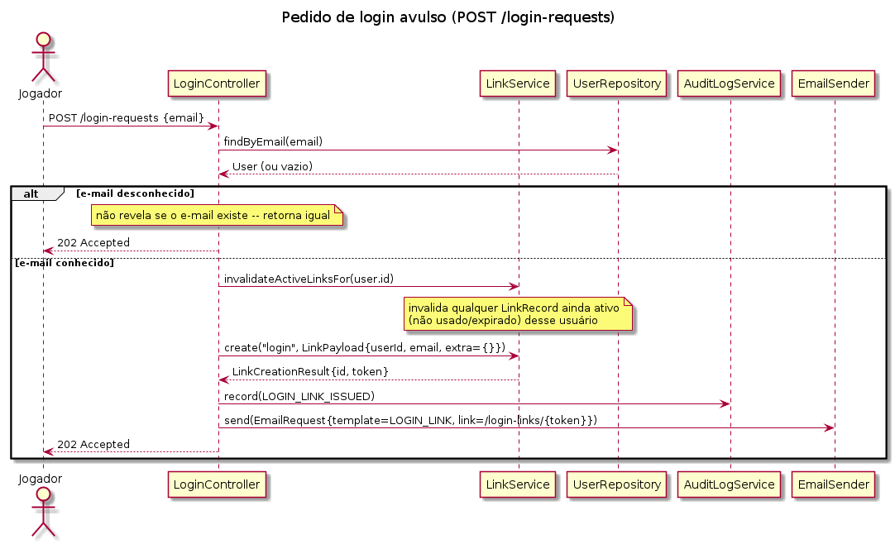
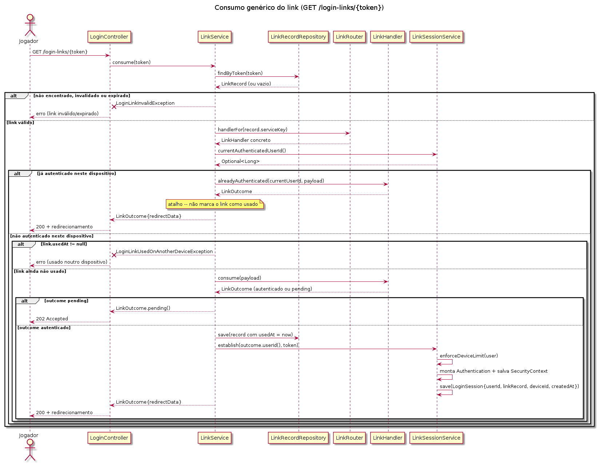
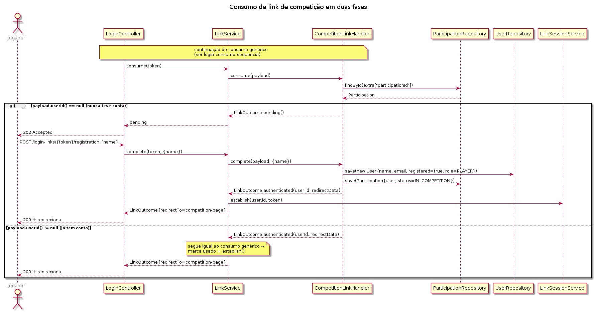

# **Projeto Jogo de Ações**

# **Introdução**

Um jogo de simulação de investimentos em bolsa: administradores criam competições — públicas (qualquer jogador pode pedir entrada) ou privadas (só quem é convidado por e-mail). Os jogadores, em uma competição por tempo determinado, começam com o mesmo saldo e, no final, se determina quem conseguiu a melhor performance. O escopo do projeto no contexto da disciplina inclui:

## **Aplicação Jogo de Ações**

* login por link recebido por e-mail  
* solicitação de ingresso clicando no link da competição pública e fornecendo o e-mail para recebimento do link  
* convites com link enviados por e-mail para ingresso em uma competição privada  
* limites de login em diferentes dispositivos  
* o administrador pode remover jogadores de competições   
* verificação do formato dos endereços de e-mail

## **Serviço de E-mail**

* verificação do formato dos endereços de e-mail  
* verificação dos registros MX e A no DNS  
* cadastro de domínios bloqueados  
* cadastro de domínios temporários  
* cadastro de domínios liberados  
* cadastro de e-mails bloqueados  
* inclusão automática do e-mail no cadastro de bloqueados dependendo da falha do envio  
* envio de e-mails via SQS e SES, com fila de mensagens não processadas (DLQ, *dead-letter queue*)  
* fila para receber status de envio que não são imediatos, como o *bounce*  
* retentativa de envio automática dependendo do erro  
* verificação de acesso ao serviço usando API-KEY

## **Função Lambda**

* envio de e-mails a partir de uma fila SQS, cujas mensagens definem os dados e o template  
* uso do DynamoDB para evitar o envio de e-mails duplicados

# Objetivos Gerais

A inteligência artificial faz parte de uma evolução tecnológica que promete revolucionar a forma de trabalhar. Por isso, buscamos uma forma de integrar essa vanguarda tecnológica ao nosso trabalho. A teoria é importante, e livros e cursos sobre o tema estão sendo lançados no mercado. No entanto, a prática também é essencial. Para colocar em prática conceitos derivados de pesquisa e experiência, buscamos um projeto que se aproximasse de uma aplicação real, e não apenas de algumas classes e protótipos.

O desenvolvimento foi pensado de forma que se assemelhasse a um projeto empresarial. Procuramos conceitos e metodologias modernas, usando como base o que aprendemos durante o curso, mas não nos limitando apenas a elas. Primeiro determinamos as iterações, com o resumo dos requisitos de cada, criando um roadmap. Esse roadmap serve como guia, podendo ser repensado ao longo do tempo. Depois especificamos o sistema. 

Decidimos vestir o chapéu de uma startup de tecnologia disposta a lançar um jogo educativo sobre compra e venda de ações. Ser uma startup traz alguns requisitos embutidos:
* baixo custo inicial de deploy;
* capacidade de atender ao crescimento da demanda.

Independentemente do futuro do projeto e de sua capacidade de trazer retorno financeiro, também nos propomos a criar um portfólio e a fortalecer nossa marca pessoal. O projeto ainda serve para aprendermos a usar a IA de forma efetiva na geração de código seguro, testável e de fácil manutenção. 

Parte da execução desse projeto foi aprovada como trabalho da disciplina de Arquitetura Avançada. Este documento trata do que desenvolvemos especificamente para atender aos requisitos da disciplina. 

# Metodologia de desenvolvimento

Criar prompts efetivos para a IA não é uma tarefa simples, tanto que já existe uma disciplina emergente dedicada a isso, a Engenharia de Prompt. Assim, em vez de tentar construir o prompt perfeito, procuramos formas de estruturar melhor a informação e de inferir se a IA entendeu o problema. Antes da disciplina, usávamos uma metodologia própria que combinava uma linguagem estruturada para especificar o sistema (Gherkin), um diagrama DER para definir o banco de dados e o modelo do sistema, a abordagem API-First, para verificar rapidamente os endpoints propostos, e arquivos que guardam o contexto da IA, evitando repetir instruções entre conversas.

O BDD (*Behavior-Driven Development*) surgiu como uma evolução do TDD (*Test-Driven Development*). Um dos problemas encontrados no TDD era o risco de alto acoplamento entre os testes e o código: testava-se o que cada método fazia, e não o comportamento esperado do sistema. O BDD também incorpora princípios do DDD (*Domain-Driven Design*), que prega o uso de uma linguagem ubíqua entre o cliente e o time de desenvolvimento. Essa linguagem deve ser usada na comunicação, na documentação e no código. 

Além disso, o BDD define o que o sistema deve fazer em instruções estruturadas, que podem ser escritas em inglês ou em qualquer outro idioma suportado. O formato permite a compreensão pelo cliente, e a estruturação facilita a compreensão pela IA. A partir dos cenários BDD, criamos testes automatizados que verificam os requisitos do sistema, ou seja, temos uma especificação executável. 

No início da disciplina, descobrimos a metodologia SDD (*Spec-Driven Development*). Essa metodologia define arquivos e processos específicos para o desenvolvimento de software com IA. Como algumas empresas e ferramentas já a utilizam, a IA já a conhece e sabe trabalhar com ela. Existe inclusive um repositório no GitHub, o Spec Kit, com vários arquivos-modelo. 

Essa metodologia busca detalhar ao máximo a especificação, as decisões técnicas e as tarefas antes da implementação. Ela pode lembrar o modelo cascata, mas há uma diferença essencial: cada especificação cobre uma pequena porção do sistema, e a IA a usa como base para a implementação.

Usamos:
* `constitution.md`: define os princípios e as regras que valem para todo o código;
* `spec.md`: define o que deve ser implementado;
* `plan.md`: registra as decisões técnicas da implementação;
* `tasks.md`: lista as tarefas a executar.

Começamos a usar SDD na Iteração 5 do projeto. Os métodos anteriores (cenários BDD, TDD e API-First) continuam em uso sempre que relevantes. No TDD, a IA cria os testes primeiro e verifica que eles falham antes da implementação. Também usamos diagramas sempre que necessário. Por exemplo, na incepção do projeto, pedimos a criação de um diagrama DER para verificar o modelo sugerido e visualizar melhor as modificações necessárias. Definimos os diagramas em texto, o que facilita a interpretação e a edição, e há várias ferramentas gratuitas para isso. No código, escolhemos o Mermaid.js, por ser suportado nativamente pelo GitHub. Neste documento, geramos os diagramas com PlantUML, porque as imagens geradas podem ser incluídas no LaTeX. 


# Refatoração dos cenários BDD

Mesmo com uma metodologia e uma sintaxe novas para nós, ao definir os passos dos cenários Gherkin, percebemos, ao fim da Iteração 1, que vários cenários repetiam os mesmos passos para preencher os campos válidos: um cenário para cada campo inválido testado. Isso contrariava o princípio de reúso. Resolvemos o problema com uma fábrica (*Object Mother*) e um *builder*, este gerado automaticamente a partir do arquivo `openapi.yaml`.

O cenário abaixo, do arquivo `create_competition.feature`, mostra o problema ao fim da Iteração 1. Para testar apenas o nome vazio, o cenário precisava repetir os passos que preenchem todos os outros campos com valores válidos, os mesmos passos de todos os outros cenários de campo inválido:

```gherkin
Scenario: Administrator tries to create a competition without a name
  Given they choose the public competition option
  And leave the competition name empty
  And define the start date
  And define the duration
  And define the buy brokerage fee
  And define the sell brokerage fee
  When they click the "create" button
  Then the system rejects the competition creation and shows an error message about the missing name
```

Na Iteração 3, deixamos no cenário apenas o que o distingue dos demais. Os valores válidos dos outros campos passaram a vir da fábrica `CompetitionMother`, que devolve um `CompetitionCreateRequest` já preenchido, e o passo sobrescreve somente o campo em teste:

```gherkin
Scenario: Administrator tries to create a competition without a name
  Given they choose the public competition option
  And leave the competition name empty
  When they click the "create" button
  Then the system rejects the competition creation and shows an error message about the missing name
```

# **Desenvolvimento para a disciplina de Arquitetura Avançada**

## **Etapa 1 — Organização Arquitetural**

Na tabela abaixo, a coluna "Antes" mostra a situação do projeto no levantamento inicial, feito em 02/09/2026, comparando o projeto com os requisitos da disciplina. A coluna "Ao fim da Etapa 1" mostra a situação na tag `etapa-1`, de 30/09/2026.

| Requisito | Antes (02/09/2026) | Ao fim da Etapa 1 (tag `etapa-1`) |
| :---- | :---- | :---- |
| Fluxo Controller → Service → Repository → BD, sem acesso direto do controller ao repository | Atendido | Atendido |
| Validação via Bean Validation | Atendido — via contrato OpenAPI (docs/openapi.yaml), que gera as anotações no DTO | Atendido |
| Tratamento de exceções centralizado | Atendido — ApiExceptionHandler com @ControllerAdvice | Atendido |
| Duas ou mais consultas Spring Data além do CRUD básico | Atendido — bem mais que duas, em vários repositórios | Atendido |
| Documentação da API via OpenAPI/Swagger | Atendido como contrato estático (docs/openapi.yaml); falta uma UI interativa (Swagger UI) rodando junto da aplicação | Atendido — o Swagger UI roda junto da aplicação, sobre o contrato estático (spec 05-009); ver "Preparação do sistema para testes com Swagger" abaixo |
| Organização de pacotes por domínio/funcionalidade, não por camada técnica | **Não atendido** — pacotes organizados por camada técnica: web/, service/, repository/, domain/, email/, captcha/ | Atendido — pacotes reorganizados por domínio (link/, login/, competition/, log/, email/, captcha/, common/); ver "Principais tarefas realizadas na Etapa 1" abaixo |
| README com módulos, dependência entre eles e candidato a serviço independente | Parcial — a informação existe implicitamente, mas não está escrita no README nesse formato | Atendido — o README lista os módulos de `app/` com as dependências entre eles, traz um exemplo de dependência e justifica o Serviço de E-mail como serviço independente (seções completadas depois da tag, na Issue #172) |
| Tag etapa-1 | **Não atendido** | Atendido |

### **Principais tarefas realizadas na Etapa 1**

Reorganizamos os pacotes de `app/` por domínio de negócio (`link`, `login`, `competition`, `log`, `email`, `captcha`, `common`), abandonando a separação anterior por camada técnica (`web`/`service`/`repository`/`domain`).

Como estudo de caso desse princípio, revisamos em seguida o mecanismo de login por link mágico enviado por e-mail. Antes da revisão, o pacote responsável pelo link tinha uma referência direta (chave estrangeira) para a competição — o mecanismo genérico de link "sabia" sobre um caso de uso específico, violando a separação de responsabilidades entre módulos. Invertemos essa dependência aplicando o Dependency Inversion Principle: os módulos consumidores (`login`, para login avulso; `competition`, para convite/pedido de entrada) passaram a implementar uma interface (`LinkHandler`) e a depender do mecanismo genérico, nunca o contrário. Com essa inversão, o pacote `link` não importa nenhum tipo dos módulos `login` e `competition`.

O diagrama abaixo mostra a arquitetura resultante: um serviço genérico (`LinkService`) orquestra o ciclo de vida do link, um roteador (`LinkRouter`) despacha pela chave de serviço gravada no link para o `LinkHandler` correto, e cada módulo consumidor implementa essa interface.



O modelo de dados acompanha essa inversão: as tabelas do mecanismo genérico (`link_record`, `login_session`) não têm mais chave estrangeira para as tabelas dos módulos consumidores.



Os diagramas de sequência a seguir documentam o fluxo completo, do pedido do link ao consumo. Primeiro, o pedido de um login avulso:



O consumo do link é genérico — o mesmo endpoint (`GET /login-links/{token}`) atende tanto ao login avulso quanto à confirmação de entrada em competição, despachando pela chave de serviço gravada no link no momento em que ele foi criado:



Por fim, quando o link é de competição e o jogador nunca teve conta, o consumo inicial fica pendente até um segundo passo (fornecer o nome) completar o cadastro:



#### Preparação do sistema para testes com Swagger

O Swagger UI, gerado a partir do contrato `docs/openapi.yaml`, monta e envia requisições HTTP para a API diretamente do navegador. Usamos essa ferramenta nos testes manuais da aplicação. Complementamos esses testes com uma suíte de testes de caixa-preta em Python (`behave` e `pytest`), que exercita a API por fora, como um cliente real, e reproduz automaticamente muitos dos problemas que encontraríamos repetindo os testes à mão.

Para testar a aplicação dessa forma, resolvemos cinco problemas.

**1. Validação do captcha.** As rotas de pedido de entrada em competição exigem um token de captcha (ALTCHA), obtido ao resolver um desafio de prova de trabalho. Como o projeto não tem um frontend que resolva esse desafio, criamos o perfil `blackbox`, empilhado sobre o perfil `docker`, no qual a aplicação aceita qualquer captcha. Nem a suíte de testes Java nem a produção ativam esse perfil, então o captcha real continua protegendo os demais ambientes.

**2. Informações sobre a execução.** Quando testamos a aplicação por fora, vemos apenas a resposta HTTP. Para acompanhar o que acontece por dentro, disponibilizamos o Adminer, uma interface web de consulta ao banco PostgreSQL, e incluímos logs de execução. Para os logs, decidimos usar programação orientada a aspectos (AOP), por ser a forma mais elegante de implementar uma especificação como "logar todas as entradas e saídas de controladores". Os *advices* definem os pontos do código em que são executados, por exemplo, em torno da execução de um método. Assim, escrevemos o código de log em um único lugar, em vez de modificar cada método (ASPECT..., [20--]). Criamos três aspectos: um para os controladores REST, um para os repositórios de acesso ao banco e um para as mensagens enviadas à fila. Todos registram em nível DEBUG, mostram só o primeiro elemento de listas longas e ficam desligados no perfil de produção.

**3. Leitura de e-mails.** O login e a entrada em competições dependem de um link que enviamos por e-mail e que a API nunca devolve na resposta. Nos ambientes de teste, o LocalStack simula o Amazon SES e oferece uma API para consultar os e-mails enviados. A suíte Python usa essa API para extrair o link de cada e-mail. Para os testes com Swagger, adicionamos ao ambiente um projeto de código aberto (`localstack-aws-ses-email-viewer`) que lista e exibe esses e-mails no navegador.

**4. Dados de competições criadas no passado.** Alguns estados do sistema, como competições já iniciadas ou encerradas, dependem de tempo decorrido. Criamos scripts Python que geram uma massa de dados repetível usando apenas a API, como faria um cliente real. Para os estados que dependem de datas passadas, executamos a aplicação com o relógio deslocado para o passado (`libfaketime`), sem alterar o código.

**5. Cabeçalhos de dispositivo.** A aplicação identifica o dispositivo de cada sessão pelos cabeçalhos `Sec-CH-UA*` (*Client Hints*) e `User-Agent`. Para simular logins em dispositivos diferentes, precisamos alterar esses cabeçalhos, mas o navegador impede que uma página envie cabeçalhos iniciados por `Sec-`. Cogitamos usar um proxy que aplicasse os cabeçalhos, mas o Swagger UI já gera, para cada requisição, o comando `curl` equivalente, com os cabeçalhos preenchidos. Executamos esse comando no terminal, que não tem essa restrição, e assim realizamos esses testes pela linha de comando.

#### Testes para mitigação de riscos na arquitetura

Nas especificações que modularizaram o sistema, registramos os riscos que a própria divisão em módulos introduzia: o uso de *strings* em pontos do código que o compilador não verifica, como os caminhos de rota nas regras de segurança e as chaves dos tratadores de link; a definição de permissões espalhada por diferentes módulos; e a documentação, no contrato OpenAPI, de quem pode acessar cada rota, que pode divergir da regra realmente aplicada. Documentar esses riscos não impede que os erros ocorram. Por isso, criamos testes automatizados para mitigá-los. Comentaremos testes semelhantes das etapas posteriores na seção correspondente.

**Permissões definidas por cada módulo.** Dividimos a configuração de segurança para que cada módulo com endpoints registre as próprias regras de acesso, por meio de uma implementação de `SecurityConfigContributor`. Essa divisão traz dois riscos: um módulo novo esquecer de registrar suas regras e dois módulos registrarem regras para as mesmas rotas. Um teste com ArchUnit verifica que todo módulo com um controlador REST possui um `SecurityConfigContributor` no mesmo pacote. O teste `RouteOwnershipTest` lê as rotas que o Spring MVC realmente registrou e verifica que cada primeiro segmento de caminho pertence a um único módulo e que nenhum módulo mapeia a raiz (`/`). Como dois módulos nunca disputam o mesmo caminho, a ordem em que aplicamos as regras de cada módulo não altera o resultado. Se ainda assim uma rota ficar sem regra, ela cai na regra central, que exige autenticação: o erro fecha o acesso, nunca o abre.

**Uso de *strings* no código.** As regras de segurança identificam as rotas por *strings*, e cada tratador de link se registra no roteador por uma chave, também uma *string*. O compilador não detecta um erro de digitação nem uma chave repetida. O teste `LinkRouterKeyUniquenessTest` verifica que todo tratador declara uma chave não nula e única e comprova que uma chave repetida impede a aplicação de iniciar. Um caminho digitado errado numa regra de segurança altera o comportamento de acesso da rota, e os cenários da suíte comportamental (Cucumber) detectam essa mudança.

**Documentação de quem pode acessar cada rota.** Seguimos a abordagem API-First, e o contrato `docs/openapi.yaml` documenta, na extensão `x-roles`, quais papéis podem acessar cada operação. Essa extensão é apenas documentação: nada a aplica em tempo de execução. O teste `OpenApiRolesConsistencyTest` compara, para cada operação do contrato, os papéis documentados com a decisão real de autorização do Spring Security, para três perfis de acesso: anônimo, jogador e administrador. O teste `OpenApiRoutesConsistencyTest` verifica que toda rota implementada está no contrato e que toda operação do contrato está implementada.


## **Etapa 2 — Separação e Comunicação entre Serviços**

Na tabela abaixo, a coluna "Antes" mostra a situação do projeto na tag `etapa-1`, de 30/09/2026. A coluna "Ao fim da Etapa 2" mostra a situação na tag `etapa-2`, de 13/10/2026.

| Requisito | Antes (tag `etapa-1`) | Ao fim da Etapa 2 (tag `etapa-2`) |
| :---- | :---- | :---- |
| Serviço independente com responsabilidade própria e justificada | Parcial — só a função Lambda (`email-lambda/`), que consome a fila de e-mail; o `app` montava e publicava as mensagens | Atendido — o Serviço de E-mail (`email-service/`) cadastra templates e envia e-mails para qualquer aplicação cliente, com banco e schema próprios |
| Comunicação síncrona via REST \+ OpenFeign | **Não atendido** — a única comunicação com outro serviço era assíncrona, pela fila SQS | Atendido — o `app` chama o Serviço de E-mail por REST, com um cliente OpenFeign e autenticação por API-Key |
| DTOs de comunicação entre serviços | Parcial — só as mensagens da fila | Atendido — DTOs gerados a partir do contrato `docs/openapi-email-service.yaml`, sem código compartilhado entre os serviços |
| Teste de disponibilidade/indisponibilidade do serviço | Não aplicável | Atendido — testes de integração contra o Serviço de E-mail real, inclusive com o serviço fora do ar |
| Tag etapa-2 | **Não atendido** | Atendido |

### **Principais tarefas realizadas na Etapa 2**

#### Serviço de E-mail

Separamos o envio de e-mail da aplicação Jogo de Ações em um serviço próprio, o Serviço de E-mail (`email-service`). Escolhemos o e-mail porque ele é uma responsabilidade genérica: qualquer aplicação que envia e-mails precisa cadastrar mensagens, controlar o remetente e, nas etapas seguintes, verificar endereços e tratar falhas de entrega. O serviço não conhece competições nem jogadores; ele atende aplicações clientes, e o Jogo de Ações é a primeira delas.

O serviço expõe uma API REST descrita no contrato `docs/openapi-email-service.yaml`, seguindo a mesma abordagem API-First da aplicação principal. Nesta etapa, ele oferece duas funcionalidades:

* **Cadastro de templates.** Cada cliente cadastra os templates de e-mail que vai usar. O serviço sincroniza cada template com o Amazon SES, que passa a renderizar as mensagens, e permite pré-visualizar um template com variáveis de exemplo.
* **Envio de e-mail.** O cliente pede o envio informando o template, o destinatário e as variáveis. O serviço valida o pedido, registra o envio, publica a mensagem na fila SQS e responde imediatamente com o identificador do envio. A função Lambda consome a fila e entrega a mensagem pelo SES. O remetente de cada cliente é fixo e definido pela equipe de operações, não pelo cliente.

**Autenticação por API-Key.** Toda chamada ao serviço leva o cabeçalho `X-API-Key`. O serviço valida a chave com a biblioteca `api-key-validation`, desenvolvida por nós num projeto separado (`lalgarve/api-key`) para ser reaproveitada por outros serviços. A chave identifica o cliente, e com ela o serviço separa os templates e o remetente de cada um.

**Persistência própria.** Cada serviço usa um schema próprio no PostgreSQL (`jogo_acoes`, `email_service` e `api_key`), e nenhum usa o schema `public`. As migrations e o histórico do Flyway de cada serviço também ficam separados. Assim, um serviço nunca lê nem escreve as tabelas do outro, mas todos podem rodar num único servidor PostgreSQL. Escolhemos essa organização porque, no início do projeto, a memória consumida por várias instâncias do banco é um custo importante.

**O Jogo de Ações como cliente.** A aplicação deixou de montar e publicar as mensagens de e-mail. Removemos dela o envio pela fila e os templates em Thymeleaf. Agora, ao iniciar, a aplicação sincroniza os próprios templates no Serviço de E-mail e, a cada login, convite ou pedido de entrada, pede o envio por `POST /emails`. A aplicação continua registrando os e-mails enviados, agora com o identificador devolvido pelo serviço.

#### Comunicação síncrona com OpenFeign

Geramos o cliente OpenFeign e os DTOs a partir do contrato do Serviço de E-mail, com o OpenAPI Generator. Assim, a aplicação não importa nenhuma classe do serviço: os dois lados dependem só do contrato.

Uma única classe da aplicação, `EmailServiceGateway`, usa esse cliente. Ela traduz as respostas de erro do serviço para exceções da própria aplicação, de modo que o restante do código não conhece o Feign nem os DTOs do serviço. Falhas de rede e respostas 5xx viram `EmailServiceUnavailableException`, que a aplicação devolve ao usuário como `503 Service Unavailable`. Uma chave rejeitada (401) vira `EmailServiceAuthenticationException`, que indica erro de configuração.

**Indisponibilidade e repetição de chamadas.** Definimos tempos-limite de 2 segundos para conectar e de 5 segundos para ler a resposta. Quando o serviço está indisponível, o *gateway* repete a chamada até três vezes, mas somente nas operações idempotentes: consultar, cadastrar ou atualizar um template e pré-visualizá-lo. Repetir essas operações deixa o serviço no mesmo estado. Não repetimos o pedido de envio: se a resposta se perder depois que o serviço publicou a mensagem, uma nova tentativa enviaria o e-mail duas vezes. Decidimos tratar a idempotência do envio, com uma chave de idempotência, na Etapa 4, junto com o processamento assíncrono.

#### Testes para mitigação de riscos na arquitetura

Nesta etapa, reforçamos dois tipos de limite: entre os módulos de `app/`, que rodam no mesmo processo, e entre os serviços, que têm implantação própria. Registramos as regras das duas fronteiras no documento de princípios do projeto (`memory/constitution.md`): módulos se comunicam por serviços Java, e serviços se comunicam só por contrato.

Dividimos o antigo módulo `login` em três: `user`, com os dados de usuário e papéis; `loginsession`, com o pedido e o consumo do link de login e a gestão de sessões; e `loginsecurity`, com a configuração de segurança HTTP. Com a divisão, o risco passou a ser um módulo depender de outro contornando esses limites.

**Dependências entre módulos.** Dois testes com ArchUnit protegem os limites entre os módulos. O primeiro verifica que os módulos de base (`user`, `loginsecurity` e `link`) não dependem uns dos outros nem do módulo `loginsession`, que depende dos três. O segundo verifica que cada repositório só é acessado de dentro do próprio módulo, de modo que os módulos se comuniquem apenas por meio de serviços. Escrevemos esse segundo teste antes das correções: ele começou falhando, listando cada acesso indevido que precisávamos corrigir, e passou quando terminamos a refatoração.

**Fronteira entre serviços.** Como a aplicação e o Serviço de E-mail estão no mesmo repositório e no mesmo projeto Maven, seria fácil reaproveitar uma classe de um no outro e acoplar os dois sem perceber. Proibimos a dependência Maven entre os dois módulos, e testes com ArchUnit, nos dois serviços, verificam que nenhum usa classes do outro. Na aplicação, outro teste verifica que só o `EmailServiceGateway` usa o cliente gerado. Testes de esquema verificam que cada serviço cria suas tabelas só no próprio schema.

**Disponibilidade do Serviço de E-mail.** Os testes de integração do cliente rodam contra o Serviço de E-mail real, iniciado pelo Docker Compose, e não contra uma simulação. Eles verificam o envio de cada tipo de e-mail, a sincronização dos templates e a repetição das operações idempotentes, que precisa deixar o serviço no mesmo estado. Para a indisponibilidade, verificamos que a aplicação não inicia com uma API-Key que o serviço rejeita e que, com o serviço fora do ar, ela falha rapidamente com `EmailServiceUnavailableException`, em vez de esperar indefinidamente.

**Testes sempre contra a infraestrutura real.** Removemos o banco H2 e o perfil `sandbox`, que permitiam rodar a aplicação sem Docker. Os testes de todos os módulos passaram a usar o PostgreSQL e o LocalStack do Docker Compose, e infraestrutura fora do ar faz o teste falhar. Uma regra de ArchUnit proíbe `Assumptions` do JUnit, para que nenhum teste seja pulado em silêncio.

#### Outras melhorias na aplicação

Além da separação do e-mail, completamos a API do jogo com novas operações, todas descritas primeiro no contrato OpenAPI:

* encerramento da sessão do dispositivo em uso (*logout*);
* resumo de um jogador, com as competições que criou e de que participa, consultado pelo próprio jogador ou pelo administrador, por identificador ou por e-mail;
* busca paginada de jogadores pelo administrador, com filtros por tipo de competição, domínio do e-mail e criação de competições;
* grupo de competições criadas pelo administrador na visão "minhas competições".

Também melhoramos o código e o ambiente de testes:

* retiramos o código de teste da aplicação de produção: a suíte Python lê os e-mails diretamente do LocalStack, e o primeiro administrador e o remetente de e-mail são criados a partir de variáveis de ambiente;
* os e-mails passaram a levar links absolutos, com a base da URL definida por ambiente;
* recuperamos a cobertura de testes, que havia caído com a troca do envio de e-mail;
* refizemos o caderno de testes manuais por funcionalidade do sistema, com uma massa de dados pronta e scripts para restaurá-la.

## **Etapa 3 — Configuração e Execução dos Serviços**

Na tabela abaixo, a coluna "Antes" mostra a situação do projeto na tag `etapa-2`, de 13/10/2026. A coluna "Ao fim da Etapa 3" mostra a situação na tag `etapa-3`, também de 13/10/2026.

| Requisito | Antes (tag `etapa-2`) | Ao fim da Etapa 3 (tag `etapa-3`) |
| :---- | :---- | :---- |
| Profiles para ao menos dois ambientes | Atendido — `docker`, `staging` e `production` na aplicação; `docker` e `production` no Serviço de E-mail | Atendido — `docker`, `staging` e `production` nos dois serviços, com a configuração de cada ambiente servida pelo Config Server |
| Configuração via variáveis de ambiente | Atendido — endereços, credenciais e segredos (ex.: SPRING\_DATASOURCE\_URL, API\_KEY\_HMAC\_PEPPER) | Atendido — segredos e endereços de infraestrutura continuam em variáveis de ambiente |
| Banco relacional real fora do ambiente local de desenvolvimento | Atendido — PostgreSQL em todos os perfis, inclusive nos testes | Atendido |
| Cada serviço com persistência própria | Atendido — um schema próprio por serviço; no Docker Compose, um container PostgreSQL para cada serviço | Atendido |
| Spring Cloud Config Server | **Não atendido** | Atendido — serviço `config-server`, que lê a configuração do diretório `config-repo/` |
| Containerização de cada aplicação | Atendido — Dockerfile da aplicação e do Serviço de E-mail; a função Lambda roda no LocalStack | Atendido — também o Dockerfile do `config-server` |
| Orquestração via Docker Compose de todos os componentes (app, serviço, bancos, Config Server) | Parcial — faltava o Config Server | Atendido — aplicação, Serviço de E-mail, Config Server, bancos, LocalStack e ferramentas de apoio aos testes |
| Tag etapa-3 | **Não atendido** | Atendido |

### **Principais tarefas realizadas na Etapa 3**

Boa parte dos requisitos desta etapa já estava atendida ao fim da Etapa 2: cada serviço tinha perfis por ambiente, banco PostgreSQL próprio e imagem Docker, e os testes já rodavam contra a infraestrutura real. Nesta etapa, concentramos o trabalho na centralização da configuração e no ambiente de execução.

#### Configuração centralizada com Spring Cloud Config Server

Criamos o serviço `config-server`, com imagem Docker própria, que entrega a configuração de cada serviço e de cada ambiente. Ao iniciar, a aplicação Jogo de Ações e o Serviço de E-mail pedem ao `config-server` a configuração correspondente ao próprio nome e ao perfil ativo, por exemplo `jogo-acoes/docker` ou `email-service/production`.

**Onde fica a configuração.** Escolhemos o *backend* `native`: o `config-server` lê os arquivos de um diretório deste repositório, `config-repo/`, com um arquivo por serviço e ambiente (`jogo-acoes-docker.yml`, `email-service-production.yml` e assim por diante). A configuração continua versionada, mas separada do código. Retiramos dos artefatos dos serviços os arquivos de configuração por ambiente: no artefato fica só o que não muda entre ambientes, como o schema do banco, a pasta das migrations e os tempos-limite do cliente OpenFeign. Assim, mudar um valor de ambiente não exige gerar uma nova imagem.

**Os dois serviços migraram juntos.** Cogitamos usar o Config Server só no serviço novo, mas isso deixaria dois jeitos de configurar ambiente no mesmo repositório. Migramos também a aplicação Jogo de Ações e, com a mudança, completamos o Serviço de E-mail com o ambiente `staging`, que ele ainda não tinha.

**Segredos fora do `config-repo/`.** Senhas, API-Keys e o *pepper* usado no cálculo do HMAC das chaves continuam em variáveis de ambiente de cada serviço. O arquivo servido pelo `config-server` traz apenas a referência à variável, por exemplo `${SPRING_DATASOURCE_PASSWORD}`, e o próprio serviço resolve o valor. O acesso ao `config-server` exige autenticação HTTP Basic, com usuário e senha também definidos por variáveis de ambiente.

**Falha rápida.** Se o `config-server` estiver fora do ar, a aplicação e o Serviço de E-mail não iniciam. Preferimos falhar na inicialização a subir um serviço com configuração parcial. No Docker Compose, os dois serviços só iniciam depois que o `config-server` está aceitando requisições.

**Testes.** As suítes de testes de cada serviço não dependem do `config-server`: usam a própria configuração de teste e desligam a importação da configuração remota. Para provar que a integração funciona, cada serviço tem um teste de integração, `ConfigServerClientIntegrationTest`, que busca a configuração no `config-server` real, iniciado pelo Docker Compose. A integração contínua roda com o `config-server` de pé.

#### Ambiente de execução

O Docker Compose sobe todos os componentes do sistema: a aplicação Jogo de Ações, o Serviço de E-mail, o `config-server`, um banco PostgreSQL para cada serviço e o LocalStack, que simula o SQS, o SES e a função Lambda. Nesta etapa, também melhoramos o ambiente usado nos testes manuais:

* adicionamos o Dozzle, um visualizador de logs no navegador. Ele mostra os logs de todos os containers, inclusive os gerados pelos aspectos de log da Etapa 1, e completa o Adminer, que mostra o banco, e o visualizador de e-mails;
* tornamos a subida do ambiente mais rápida: o container que empacota a função Lambda só executa o build quando o código da função mudou;
* documentamos no README o endereço de cada serviço e ferramenta, incluindo o Swagger UI.

## **Etapa 4 — Comunicação Assíncrona e Processamento em Lote**

Na tabela abaixo, a coluna "Antes" mostra a situação do projeto na tag `etapa-3`, de 13/10/2026. A coluna "Ao fim da Etapa 4" mostra a situação no repositório em 14/10/2026.

| Requisito | Antes (tag `etapa-3`) | Ao fim da Etapa 4 |
| :---- | :---- | :---- |
| Mensageria assíncrona real (produtor/fila/consumidor) | Atendido — o Serviço de E-mail publica cada pedido de envio numa fila SQS, consumida pela função Lambda, que entrega pelo SES | Atendido |
| Tecnologia de mensageria \= a definida pelo professor em aula | A confirmar — o enunciado cita RabbitMQ como exemplo; o projeto usa Amazon SQS | A confirmar |
| Processamento em lote com Spring Batch (Job/Step/ItemReader/ItemProcessor/ItemWriter) | **Não atendido** | Atendido — importação das listas de domínios de e-mail temporário no Serviço de E-mail |
| Tag etapa-4 | **Não atendido** | **Não atendido** |

### **Principais tarefas realizadas na Etapa 4**

#### Mensageria assíncrona no envio de e-mail

A comunicação assíncrona do sistema está no envio de e-mail e foi construída junto com o Serviço de E-mail, na Etapa 2. O Serviço de E-mail é o produtor: ao aceitar um pedido de envio, ele grava o envio e publica na fila SQS uma mensagem com o template, o remetente, o destinatário, as variáveis e um identificador de correlação. A função Lambda é a consumidora: o LocalStack, que simula a AWS nos ambientes de desenvolvimento e de testes, entrega cada mensagem da fila à função, que pede ao SES o envio do e-mail a partir do template. A função não conhece templates, clientes nem regras do jogo, e o identificador de correlação segue como etiqueta da mensagem no SES, para que eventos posteriores, como um *bounce*, possam ser associados ao envio original.

A fila separa o tempo de resposta da API do tempo de entrega: o Serviço de E-mail responde assim que publica a mensagem, e uma falha na entrega não chega ao usuário que pediu o login. Quando a função falha, ela não trata a repetição: a mensagem volta para a fila e o SQS a entrega de novo.

#### Verificação do domínio do destinatário

Cada e-mail para um endereço que não existe vira um *bounce* no SES. Os *bounces* pesam na reputação da conta, e, acima de um limite, a AWS suspende o envio da conta inteira. Para reduzir esse risco, o Serviço de E-mail passou a verificar, antes de aceitar um pedido de envio, se o domínio do destinatário recebe e-mail. Ele consulta no DNS os registros MX do domínio e, na falta deles, os registros A, como define a RFC 5321. Um domínio que não recebe e-mail é recusado com `422`, sem gravar nem publicar nada.

Como a maior parte dos e-mails vai para poucos domínios, mantemos uma lista branca: um domínio aprovado é gravado e não é consultado de novo no DNS.

#### Processamento em lote: atualização da tabela de domínios de e-mail temporário

Para evitar cadastro de usuários usando e-mails temporários, usamos listas gratuitas publicadas na internet. Endereços de serviços de e-mail temporário deixam de existir depois de alguns minutos: um jogador que entra com um deles não recebe o próximo link de login, e o e-mail para ele vira *bounce*. Esses domínios têm registros MX válidos, então a verificação pelo DNS não os detecta. As listas são grandes, com dezenas de milhares de linhas, e mudam com frequência. Por isso, importamos as listas para uma tabela do Serviço de E-mail por meio de um processamento em lote, em vez de consultá-las a cada envio.

**Repositórios das listas.** As listas vêm de repositórios cadastrados numa tabela, com o endereço do arquivo, uma descrição, a hora do último download e a hora da última atualização da tabela de domínios. A equipe de operações cadastra os repositórios e pede a execução do lote pela API do serviço. O pedido responde `202` com o identificador da execução, e o lote roda em segundo plano. A situação de cada execução pode ser consultada depois, com o número de linhas lidas, de domínios incluídos e removidos e de linhas ignoradas.

**O *job* do Spring Batch.** Para cada repositório, o *job* executa três *steps*:

1. `downloadStep`, um *tasklet*, baixa a lista para um arquivo temporário. Se a lista for igual à última importada, o *job* termina aqui, sem mexer na tabela.
2. `importStep` processa o arquivo em blocos (*chunks*) de 1.000 linhas. O `ItemReader` (`FlatFileItemReader`) lê o arquivo linha a linha. O `ItemProcessor` (`DisposableDomainLineProcessor`) ignora linhas em branco e comentários, normaliza o domínio (sem espaços, em minúsculas e, se internacionalizado, na forma ASCII) e descarta as linhas que não são domínios, que o *step* conta como ignoradas. O `ItemWriter` (`JdbcBatchItemWriter`) grava os domínios na tabela.
3. `pruneStep`, outro *tasklet*, remove os domínios do repositório que não estão mais na lista.

O `ItemWriter` faz *upsert*: gravar a mesma lista de novo não duplica nenhum domínio. Assim, uma execução interrompida no meio pode ser pedida de novo e termina o trabalho. Um repositório fora do ar, ou que devolve uma lista vazia, faz a execução falhar sem alterar a tabela, e os demais repositórios continuam sendo importados. Duas execuções do mesmo repositório não rodam ao mesmo tempo.

**Uso no envio.** A verificação do destinatário consulta a tabela antes da lista branca e do DNS: um endereço de um domínio temporário, ou de um subdomínio dele, é recusado com `422`. Um domínio pode estar em mais de um repositório e continua valendo enquanto pelo menos um deles o tiver.

**Permissões por chave de API.** Administrar as listas é tarefa da equipe de operações, não das aplicações clientes. Para separar os dois papéis, acrescentamos permissões às chaves na biblioteca de API-Key (versão 1.1.0). O Serviço de E-mail define duas permissões: `email:send`, para enviar e-mails e manter os próprios templates, e `disposable-email:admin`, para administrar as listas. A chave do Jogo de Ações tem só a primeira, e a chave de operações, só a segunda. Uma chave sem a permissão exigida pela rota recebe `403`.


# Conclusão

Separar o código em módulos por domínio, mesmo sem mudar nenhuma lógica, já nos mostrou onde a arquitetura podia melhorar e onde aplicar padrões de projeto. Com as classes agrupadas por funcionalidade, ficou visível que o mecanismo genérico de link tinha uma chave estrangeira para a competição, ou seja, que um módulo de base conhecia um caso de uso específico. Corrigimos isso invertendo a dependência: o módulo de link passou a definir a interface `LinkHandler`, e o módulo de competição a implementa, como qualquer outro consumidor. A mesma separação mostra o próximo passo: o módulo de competição continua complexo. É o maior da aplicação, com 27 classes, quase o dobro do segundo maior, e reúne responsabilidades que provavelmente podem ser divididas em submódulos, como o pedido de entrada em competições, a gestão dos jogadores de uma competição e a busca de jogadores pelo administrador. Na organização anterior, por camada técnica, nenhuma dessas questões chamava atenção, porque as classes ficavam diluídas entre os pacotes `service`, `repository` e `domain`.

Proibir o acesso direto a repositórios de outro módulo também melhorou o código. Para cumprir a regra, cada módulo precisou declarar, num serviço público, o que oferece aos demais. O levantamento feito para essa mudança encontrou a consulta do usuário logado copiada em cinco lugares e a criação de usuário com papel copiada em dois; as cópias foram substituídas por um serviço único. Além disso, o que cada serviço precisa de outro módulo passou a estar escrito na sua lista de dependências, e não espalhado em consultas ao banco.

As regras de arquitetura só se mantiveram porque são verificadas a cada build. Os testes com ArchUnit impedem um módulo de acessar o repositório de outro, impedem a aplicação e o Serviço de E-mail de compartilharem classes e garantem que cada módulo registre as próprias regras de segurança. Sem essa verificação, bastaria uma importação feita por descuido, ou sugerida pela ferramenta de IA, para desfazer a separação sem que ninguém percebesse.

Os testes manuais encontraram problemas que os testes automáticos não mostravam, inclusive no ambiente e na documentação. Executar os cadernos de testes revelou, por exemplo:

* que uma sessão encerrada pelo limite de dispositivos continuava autenticada;
* que o assunto de um template com acentos voltava com os caracteres trocados na pré-visualização;
* que a aplicação deixava de iniciar quando o LocalStack era recriado e o Serviço de E-mail mantinha no banco templates que o SES já não tinha;
* comandos e respostas da documentação que não correspondiam mais ao sistema.

Os testes automáticos rodam sempre num ambiente limpo e verificam o que foi previsto; os manuais usam o sistema como um usuário usaria, num ambiente que acumula estado entre uma execução e outra. Os dois tipos de teste se complementam.

Seguir a abordagem API-First nos dois serviços também simplificou a separação. Como a aplicação e o Serviço de E-mail dependem apenas do contrato OpenAPI, cada um pôde mudar por dentro sem afetar o outro, e o cliente OpenFeign e os DTOs foram gerados a partir do contrato, sem código compartilhado.

Por fim, desenvolver com IA a partir de especificações escritas antes do código, com BDD e SDD, deu bons resultados. Cada mudança partiu de uma especificação revisada, com as decisões técnicas e as tarefas registradas, o que nos permitiu retomar o trabalho entre sessões e revisar com cuidado o código gerado.

Ficam pendentes a falha de sessão encontrada no caderno de testes, a recriação automática de templates ausentes no SES e a confirmação de que o Amazon SQS é aceito no lugar da tecnologia de mensageria vista em aula.

# Bibliografia

ASPECT Oriented Programming (AOP) in Spring Framework. *GeeksforGeeks*, [20--]. Disponível em: https://www.geeksforgeeks.org/advance-java/aspect-oriented-programming-aop-in-spring-framework/. Acesso em: 5 out. 2026.

GITHUB. **Spec Kit**: tasks-template.md. [*S. l.*]: GitHub, 2026. Disponível em: https://github.com/github/spec-kit/blob/main/templates/tasks-template.md. Acesso em: 16 set. 2026.

GRAZIANO, Alfonso. **AI-Native Software Engineering**. Sebastopol, CA: O'Reilly Media, 2026. E-book. Versão preliminar (*early release*); publicação prevista para fev. 2027. Disponível em: https://learning.oreilly.com/library/view/ai-native-software-engineering/0642572352530/. Acesso em: 24 set. 2026.

SMART, John Ferguson. **BDD in Action**: Behavior-Driven Development for the Whole Software Lifecycle. Shelter Island, NY: Manning Publications, 2014. E-book. ISBN 978-1-61729-165-4. Disponível em: https://learning.oreilly.com/library/view/bdd-in-action/9781617291654/. Acesso em: 24 set. 2026.

WILDRIK. **Spec Driven Development**: o futuro de programar com IA (SDD). *techknow*, 25 abr. 2026. Disponível em: https://www.techknow.com.br/post/spec-driven-development. Acesso em: 16 set. 2026.
