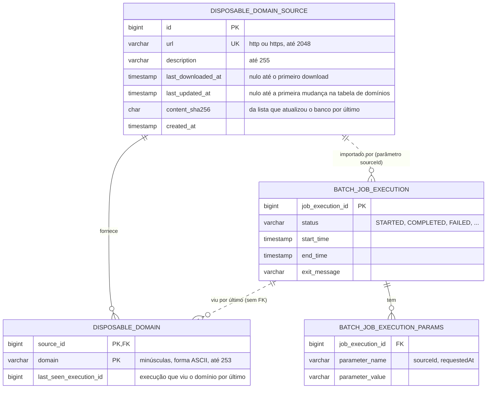

# Data model: Importação em lote das listas de domínios de e-mail temporário

Mesmo desvio da spec [05-025](../05-025-servico-email-templates/data-model.md): o DER geral em
`docs/diagrams/der.md` é do domínio do `app`. Estas tabelas são do `email-service`, no schema
`email_service`, e ficam neste arquivo.

## DER

`BATCH_JOB_EXECUTION` e `BATCH_JOB_EXECUTION_PARAMS` são tabelas do Spring Batch (criadas pela
migration copiada do `schema-postgresql.sql`, ver `plan.md`); aparecem aqui só com as colunas que
esta feature lê. As outras tabelas de metadados do Spring Batch (`BATCH_JOB_INSTANCE`,
`BATCH_STEP_EXECUTION`, contextos e sequências) não aparecem. As linhas pontilhadas são ligações
sem chave estrangeira.

## Entidades

### DisposableDomainSource (`disposable_domain_source`)

| Campo | Tipo | Obrigatório | Validação |
|---|---|---|---|
| `id` | `bigserial` | sim | gerado pelo banco |
| `url` | `varchar(2048)` | sim | único; esquema `http` ou `https` |
| `description` | `varchar(255)` | sim | não vazio |
| `last_downloaded_at` | `timestamp` | não | gravado a cada download com sucesso, mesmo com a lista igual |
| `last_updated_at` | `timestamp` | não | gravado só quando a execução incluiu ou removeu algum domínio |
| `content_sha256` | `char(64)` | não | SHA-256 da última lista importada até o fim; gravado no `pruneStep` |
| `created_at` | `timestamp` | sim | definido na criação |

### DisposableDomain (`disposable_domain`)

| Campo | Tipo | Obrigatório | Validação |
|---|---|---|---|
| `source_id` | `bigint` | sim | FK para `disposable_domain_source`, `ON DELETE CASCADE` |
| `domain` | `varchar(253)` | sim | minúsculas, forma ASCII (`IDN.toASCII`), rótulos de 1 a 63, pelo menos um ponto |
| `last_seen_execution_id` | `bigint` | sim | id da execução do Spring Batch que gravou ou viu o domínio por último; sem FK |

Chave primária `(source_id, domain)`; índice em `domain` para a consulta do `POST /emails`.

## Relacionamentos

- Um repositório fornece zero ou mais domínios. Apagar o repositório apaga os domínios dele.
- O mesmo domínio pode aparecer em vários repositórios (uma linha por repositório). Ele vale para
  a verificação do destinatário enquanto existir pelo menos uma linha.
- Cada execução do job importa um repositório só, identificado pelo parâmetro `sourceId`. Não há
  FK: o Spring Batch guarda parâmetros como texto.
- `last_seen_execution_id` aponta para a execução que viu o domínio por último, sem FK, para não
  amarrar a limpeza dos metadados do Spring Batch aos dados da feature.
- Nenhuma ligação com `approved_domain` (05-047) nem com as outras tabelas do `email-service`. A
  regra entre elas é de consulta: um domínio em `disposable_domain` é recusado antes de olhar a
  lista branca.

## Invariantes

- `url` é única entre os repositórios.
- Depois de uma execução `COMPLETED` de um repositório, as linhas dele em `disposable_domain` são
  exatamente os domínios válidos da lista baixada.
- `content_sha256` só muda quando a execução termina; uma execução que falha no meio deixa o valor
  antigo, e a próxima refaz a importação inteira.
- `last_updated_at` nunca é mais recente que `last_downloaded_at`.
- Uma execução que falha no download não muda nada do repositório. Uma que falha depois do
  download fica com o `last_downloaded_at` novo e com os domínios novos já gravados pelo
  `importStep`, mas não remove nada nem muda `last_updated_at` e `content_sha256`; a próxima
  execução termina o trabalho.
