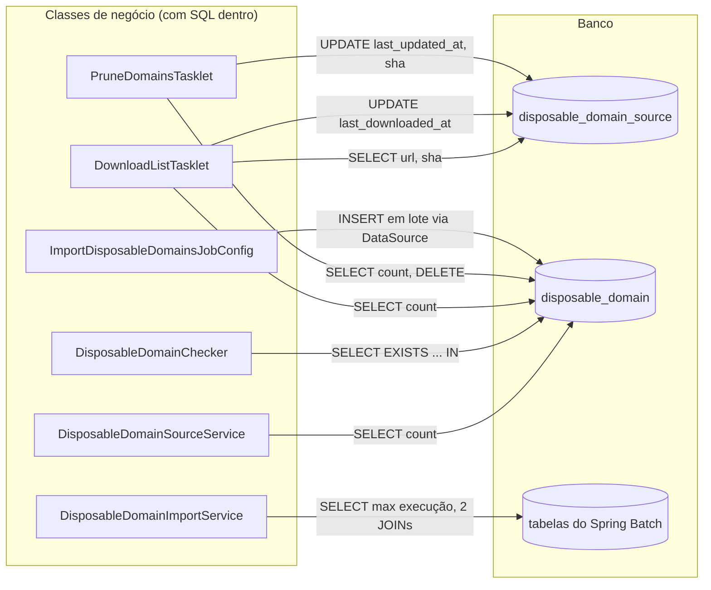
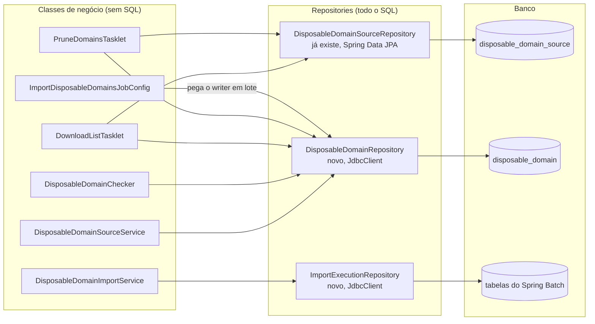
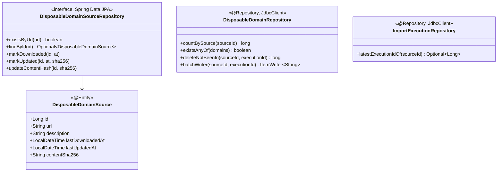
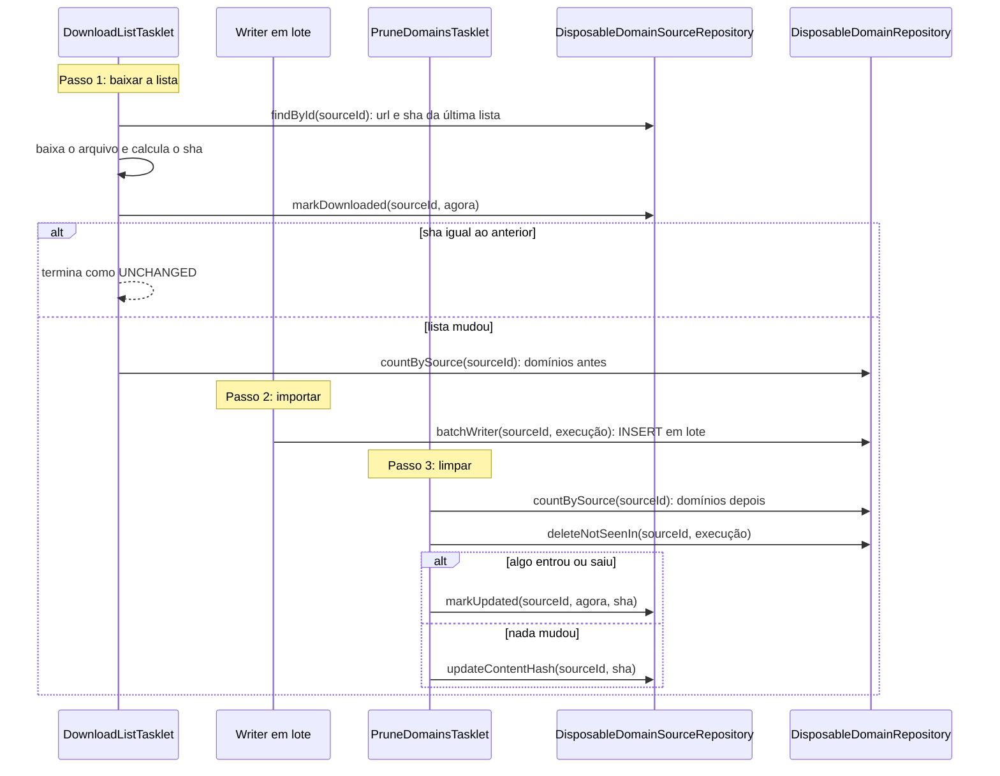

# Spec: Camadas dentro dos módulos

**Status:** especificada, aguardando implementação
**Issue:** —
**Iteração:** iteration-5

## Resumo

Um teste de arquitetura em cada serviço (`app` e `email-service`) garante que as classes seguem
três camadas, sem atalho: **controller → service → repository**. Controller recebe a requisição
e chama service; service tem a regra e chama repository; só repository acessa o banco. Nenhuma
camada de baixo depende de uma de cima. Antes do teste, o SQL espalhado no pacote `disposable`
do `email-service` vai para repositories (padrão Repository).

## Motivação

- **Pedido da Leila (2026-10-26):** regra de dependência entre camadas, escolhida entre as
  sugestões da spec [05-061](../05-061-sem-ciclos-entre-modulos/spec.md).
- A 05-061 cuida das dependências **entre** módulos; esta cuida das dependências **dentro** de
  cada módulo. Hoje nada impede um controller de chamar um repository direto, nem um service de
  depender de um controller.
- **Situação atual** (conferida em 2026-10-26 pelo código-fonte de `origin/development`, sem
  rodar o teste): nenhum controller usa repository, nenhuma classe de produção usa controller e
  nenhum repository usa service. Mas seis classes do `email-service` (`disposable`) acessam o
  banco fora de repository: cinco com `JdbcTemplate` e uma com `DataSource` (ver "Acesso a banco
  no `disposable`").

## As camadas

Os módulos não têm subpacotes por camada (`competition` tem controller, service e repository no
mesmo pacote), então a camada vem do papel da classe, não do pacote:

| Camada | Classes |
|---|---|
| Controller | Anotadas com `@RestController` ou `@Controller` |
| Repository | Interfaces do Spring Data (que estendem `org.springframework.data.repository.Repository`) e classes anotadas com `@Repository` |
| Service | Todas as outras classes de produção: services, handlers, mappers, entidades, configuração, filtros |

## Acesso a banco no `disposable`

No `email-service`, o pacote `disposable` (listas de e-mail temporário, specs 05-048 e 05-054)
tem SQL espalhado em seis classes de negócio. Esta spec aplica o padrão Repository: todo SQL de
uma tabela fica numa classe só, e services e tasklets chamam métodos com nome de negócio. O
comportamento não muda: mesmos passos, mesma ordem, mesmo SQL.

O resto do `email-service` já segue o padrão. Por exemplo, a lista branca de domínios
(`domain`, spec 05-047) tem o único SQL dela no `ApprovedDomainRepository`.

### Antes: seis classes com SQL

Cada seta é um SQL escrito dentro da classe. Três classes contam os domínios de uma lista com o
mesmo `SELECT count(*)`. A tabela de listas já tem entidade JPA e repository, mas mesmo assim é
atualizada por SQL em dois tasklets.

### Depois: um repository por tabela

As classes de negócio só falam com repositories, e só os repositories falam com o banco.

### Os três repositories

Cada SQL que existe hoje vira exatamente um método; nenhum SQL novo aparece. Nomes de método são
sugestão, definidos na implementação.

- **`DisposableDomainSourceRepository`** já existe e ganha três métodos `@Modifying @Query` para
  os `UPDATE`. A entidade passa a mapear `content_sha256`. Hoje ela não mapeia essa coluna, e por
  isso o tasklet a lê com SQL.
- **`DisposableDomainRepository`** é novo e é o único dono da tabela `disposable_domain`. O
  `batchWriter` monta o `JdbcBatchItemWriter` com o `INSERT ... ON CONFLICT` que hoje está no
  `ImportDisposableDomainsJobConfig`.
- **`ImportExecutionRepository`** é novo e guarda a única consulta às tabelas do Spring Batch. O
  resto continua usando a API do Spring Batch (`JobRepository`).

### A importação passo a passo, depois da mudança

Fora da importação, o `DisposableDomainChecker` chama `existsAnyOf` quando o
`RecipientDomainVerifier` confere o domínio do destinatário, e a listagem de repositórios chama
`countBySource` e `latestExecutionIdOf`.

### Como fica cada classe

| Classe | Hoje | Depois |
|---|---|---|
| `DisposableDomainSourceService` | `SELECT count(*)` para mostrar quantos domínios a lista tem | `countBySource(id)` |
| `DisposableDomainChecker` | Monta `SELECT EXISTS ... WHERE domain IN (?, ?, ...)` com o domínio e os pais dele | Calcula os candidatos e chama `existsAnyOf(candidatos)` |
| `DisposableDomainImportService` | `SELECT max(job_execution_id)` com dois `JOIN` nas tabelas do Spring Batch | `latestExecutionIdOf(sourceId)` e depois `JobRepository`, como hoje |
| `DownloadListTasklet` | `SELECT url, content_sha256`, `UPDATE last_downloaded_at`, `SELECT count(*)` | `findById`, `markDownloaded`, `countBySource` |
| `PruneDomainsTasklet` | `SELECT count(*)`, `DELETE` dos não vistos, um de dois `UPDATE` | `countBySource`, `deleteNotSeenIn`, `markUpdated` ou `updateContentHash` |
| `ImportDisposableDomainsJobConfig` | Recebe `DataSource` e escreve o `INSERT ... ON CONFLICT` | Pede `batchWriter(sourceId, execução)` |

Nenhuma dessas classes continua com `JdbcTemplate`, `DataSource` ou SQL.

## Cenários (comportamento esperado)

Não há `.feature` novo: a mudança é na forma de testar, não no comportamento dos serviços.
Verificação:

1. **Código atual:** o teste passa no `app` e no `email-service` (este depois da refatoração do
   `disposable`).
2. **Controller usando repository:** um controller que receba um `UserRepository` no construtor
   faz o teste falhar, e a mensagem diz o controller e o repository.
3. **Controller usando API de banco:** um controller que use `JdbcTemplate` ou `EntityManager`
   também falha.
4. **Service usando controller:** uma classe que não é controller e referencia um controller
   (campo, parâmetro, chamada) faz o teste falhar.
5. **Repository usando service ou controller:** um repository que referencie um service ou um
   controller faz o teste falhar.
6. **Service usando API de banco:** um service que receba um `JdbcTemplate` faz o teste falhar.
7. **Importação igual à de antes:** depois da refatoração, a suíte do `email-service` passa sem
   mudar nenhum teste de comportamento, e uma importação de lista no ambiente local dá o mesmo
   resultado (domínios adicionados, removidos e o estado da lista).
8. **Comentário não conta:** citar um controller em Javadoc (como `PlayerSummaryView` faz) não
   é dependência e não falha.

## Requisitos funcionais

- **Só repository acessa o banco:** nenhuma classe fora da camada repository depende de API de
  acesso a banco (`JdbcTemplate`, `NamedParameterJdbcTemplate`, `JdbcClient`, `EntityManager`,
  `DataSource`).
- **Controller** não depende de repository.
- **Nenhuma classe** depende de controller. Quem chama controller é o Spring.
- **Repository** não depende de service nem de controller; pode depender de entidades e
  projeções (`PlayerSummaryView`), que ficam na camada de service pela tabela acima.
- A regra continua valendo junto da que já existe no `app`: repository só é acessado pelo
  próprio módulo (`repositoriesAreOnlyAccessedFromTheirOwnModule`).
- Classes geradas do OpenAPI (pacote `api`) ficam fora da regra: são interfaces e modelos que o
  controller implementa e usa.
- Só classes de produção (`src/main`) entram; testes ficam de fora.
- **Refatoração do `disposable`** conforme "Acesso a banco no `disposable`": dois repositories
  novos, três métodos no `DisposableDomainSourceRepository`, `content_sha256` mapeado na entidade
  e nenhum SQL nas seis classes. Sem mudança de comportamento, de tabela nem de contrato.
- **Constitution:** a seção "Fronteira entre módulos e serviços" ganha a regra de camadas,
  garantida por teste de arquitetura.

## Requisitos não-funcionais

- O teste roda na suíte normal (`mvn test`), sem infraestrutura de pé.

## Fora de escopo

- Ciclos entre módulos: spec [05-061](../05-061-sem-ciclos-entre-modulos/spec.md).
- Reorganizar os módulos em subpacotes por camada.
- `email-lambda` e `config-server`: não têm controller nem repository.

## Decisões resolvidas

- **Camada pelo papel da classe, não pelo pacote**: os módulos são pacotes únicos; criar
  subpacotes por camada seria uma reorganização grande sem pedido.
- **Só repository acessa o banco, com o padrão Repository no `disposable`** (Leila,
  2026-10-26). Descartado: permitir `JdbcTemplate` em service, que deixaria o SQL espalhado.
- **JDBC, não JPA, na tabela `disposable_domain`**: ela recebe listas inteiras em lote e apaga
  em massa o que saiu da lista. JPA grava uma entidade por vez e exigiria `@Query` nativo para o
  `INSERT ... ON CONFLICT` e o `DELETE`. O padrão é o mesmo (Repository), com `JdbcClient`. A
  tabela de listas tem poucas linhas e entidade, então fica no Spring Data JPA.

## Decisões em aberto

Nenhuma.
